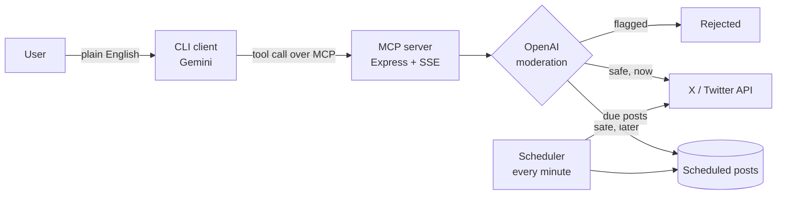

# TweetGuard

An AI agent that posts and schedules tweets from plain-English commands, with a moderation check before anything is published.

```
You: schedule "Shipping a new feature today 🚀" in 30 minutes
→ calling tool createPost
AI: Done! Your tweet is scheduled (id: 3f9a1c2e) for 4:30 PM.
```

## How it works



1. **Client:** a terminal chat powered by Gemini. It reads the tools the server offers and lets the model decide when to call them.
2. **MCP server:** exposes tweet actions as [Model Context Protocol](https://modelcontextprotocol.io) tools over Server-Sent Events. Inputs are validated with Zod.
3. **Moderation:** every tweet goes through OpenAI's moderation model first. If the check fails for any reason, the tweet is rejected (fail safe).
4. **Scheduler:** scheduled tweets are saved to disk, and a background job publishes them when they're due, so nothing is lost if the server restarts.

## Tools

| Tool | What it does |
|---|---|
| `createPost` | Post a tweet now, or schedule it with `delayInMinutes` |
| `listScheduledPosts` | Show tweets waiting to be posted |
| `cancelScheduledPost` | Cancel a scheduled tweet by id |

## Tech stack

Node.js · Express · MCP SDK · Gemini API · OpenAI Moderation API · Twitter API v2 · node-cron · Zod

## Setup

**Requirements:** Node.js 18+, an X developer account (read & write access), an OpenAI API key and a Gemini API key.

```bash
# 1. Server
cd server
npm install
cp .env.example .env   # add your OpenAI and X keys
npm start              # runs on http://localhost:3001

# 2. Client (in a new terminal)
cd client
npm install
cp .env.example .env   # add your Gemini key
npm start
```

## Example commands

- `Tweet "Hello world from TweetGuard"`
- `Schedule a tweet saying "Good morning!" in 2 hours`
- `What tweets do I have scheduled?`
- `Cancel the scheduled tweet 3f9a1c2e`

## Project structure

```
server/
  index.js       MCP server and tool definitions
  mcp.tool.js    Tool logic, moderation and scheduler
  store.js       Saves scheduled posts to a JSON file
client/
  index.js       Gemini chat client that calls MCP tools
```
